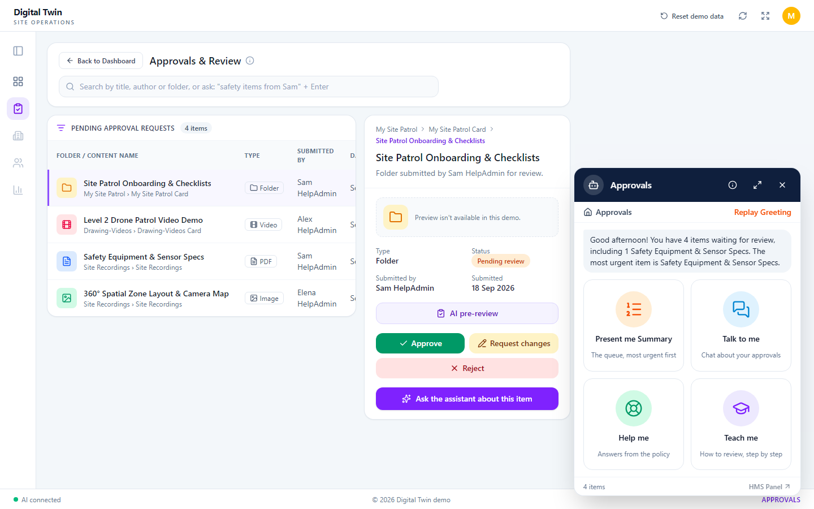
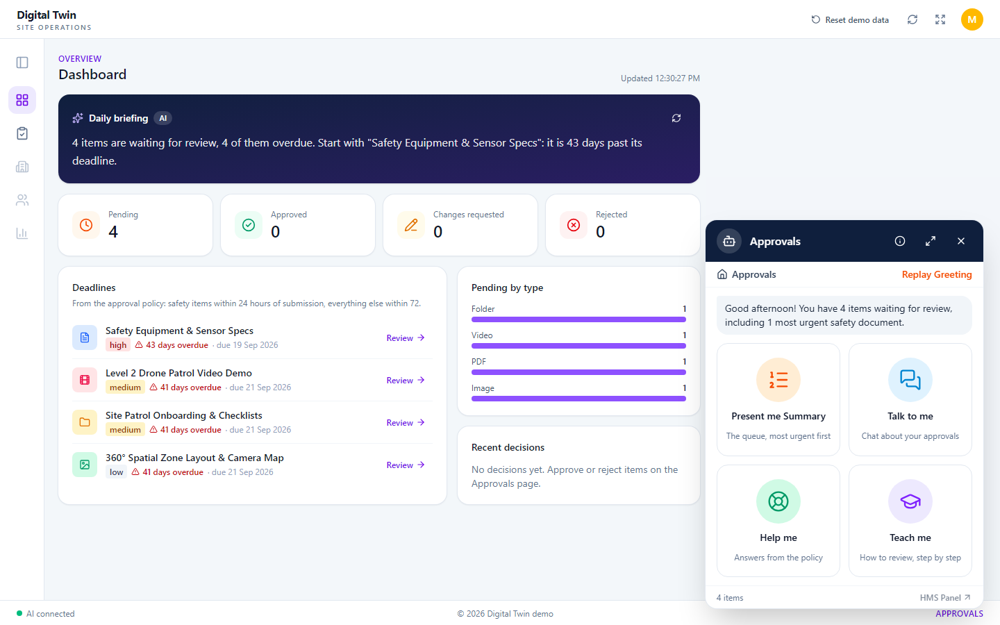

# Crystal Ball Command Centre: Approvals AI Assistant

Take-home assignment for **Sr. Fullstack Developer, MERN + AI (Wave 2)**. A working rebuild of the **"Approvals" assistant panel** from a digital-twin dashboard. A Next.js page shows the
approvals queue with a floating assistant; an Express API calls Claude server-side. The panel has five actions:

| Action                 | What it does                                                      | Output                                      |
| ---------------------- | ----------------------------------------------------------------- | ------------------------------------------- |
| **Present me Summary** | Explains the pending queue, most urgent first                     | Streamed NDJSON, each item validated by Zod |
| **Talk to me**         | Free multi-turn chat about the queue                              | Streamed text                               |
| **Help me**            | Answers operational questions only from the policy (mini RAG)     | Sources, then streamed text                 |
| **Teach me**           | Step-by-step guide to reviewing an approval, adapts to follow-ups | Streamed text                               |
| **Replay Greeting**    | Short context-aware greeting ("4 items waiting…")                 | JSON, validated by Zod                      |

Every action has a deterministic, non-AI fallback. No API key, a timeout, a model error or invalid model output never
breaks the UI: the user always gets a usable answer, marked "AI unavailable, showing a standard answer".



The page has a searchable queue, a detail pane for the selected item, and a status bar showing whether the AI is
connected. More views: [summary with fallback items](docs/screenshots/panel-summary.png) ·
[mobile, where the panel docks full-width at the bottom](docs/screenshots/panel-mobile.png).

The layout follows the reference dashboard's structure, but uses an original name and Lucide icons instead of
OomniEye's logo and illustrations.

### Beyond the five actions

The rest of the page works too, with the same rules: code decides facts, the AI only writes text or filters, every AI
reply is validated, and each has a deterministic fallback.

| Feature                     | Where                    | AI's role, and why                                                                                                                               |
| --------------------------- | ------------------------ | ------------------------------------------------------------------------------------------------------------------------------------------------ |
| **Approve / reject**        | Detail pane              | **None.** A decision is the reviewer's, so the AI never makes or suggests one.                                                                   |
| **AI pre-review**           | Detail pane              | Tailors a checklist to the item; each check must cite a policy section. Code sets the deadline. No verdict: it only sees metadata, not the file. |
| **Draft with AI**           | Request changes / reject | Turns the reviewer's notes into a polite comment, which they edit before sending. No numbers beyond the notes and policy.                        |
| **Dashboard**               | `/dashboard`             | **None** for the figures (counts, deadlines, overdue): that's arithmetic.                                                                        |
| **Daily briefing**          | Dashboard                | Words the computed figures. It may not add numbers and must start with the item code chose.                                                      |
| **Search in plain English** | Approvals page           | Turns "safety items from Sam" into a filter of known values; code applies it. One-word searches never call the AI.                               |



**Reset demo data** in the top bar undoes every decision (the queue lives in memory, so a restart does the same).

## Requirements checklist

Each line of the brief, and where to find it. ✅ done · ⏳ still to do · ➖ optional, not done.

**§1 The panel and its five actions**

- ✅ Panel matching the reference: avatar and header, action cards, close button →
  [`AssistantPanel.tsx`](apps/web/components/assistant/AssistantPanel.tsx)
- ✅ 🧾 **Present me Summary**: the queue ranked by urgency, as text or read aloud, in the operator's language →
  [`summaryService.ts`](apps/api/src/services/summaryService.ts), [`ReadAloudButton.tsx`](apps/web/components/assistant/ReadAloudButton.tsx)
- ✅ 💬 **Talk to me**: multi-turn chat about the queue → [`chatService.ts`](apps/api/src/services/chatService.ts)
- ✅ 📚 **Help me**: answers only from the policy note → [`helpService.ts`](apps/api/src/services/helpService.ts)
- ✅ 🎓 **Teach me**: step-by-step review guide that adapts to follow-ups → [`teach.v1.1.ts`](apps/api/src/prompts/teach.v1.1.ts)
- ✅ 👋 **Replay Greeting**: regenerated each time, with the live pending count →
  [`greetingService.ts`](apps/api/src/services/greetingService.ts)

**§2 Reference data**

- ✅ 📦 The four queue items seeded in the repo → [`data/approvals.json`](data/approvals.json)
- ✅ 📄 Policy note in my own words (200–400 words) → [`data/policy.md`](data/policy.md)
- ✅ 🔎 Keyword retrieval over 5 chunks, no pgvector → [`retrieval.ts`](apps/api/src/domain/retrieval.ts)

**§3 Technical requirements**

- ✅ ⚛️ React + Next.js (App Router), with visible loading and error states → [`apps/web`](apps/web)
- ✅ 🌊 Token-by-token streaming over SSE → [`sseClient.ts`](apps/web/lib/sseClient.ts), [`sse.ts`](apps/api/src/http/sse.ts)
- ✅ 🗃️ Zustand for conversation and session state, no prop-drilling → [`assistantStore.ts`](apps/web/store/assistantStore.ts)
- ✅ 🟩 Node.js + Express, TypeScript strict mode → [`apps/api`](apps/api)
- ✅ 📐 Zod schemas written before the routes → [`packages/contracts`](packages/contracts/src), [`openapi.md`](packages/contracts/openapi.md)
- ✅ 🔐 Claude through the Anthropic SDK, server-side only; the key never reaches the browser →
  [`AnthropicLlmClient.ts`](apps/api/src/llm/AnthropicLlmClient.ts). Not run with a live key (see §2 Testing); a free
  local model (Ollama) runs behind the same interface.
- ✅ 🧱 Summary and greeting return JSON validated with Zod before reaching the UI, never regex-parsed →
  [`summaryParser.ts`](apps/api/src/services/summaryParser.ts)
- ✅ 🏷️ Versioned prompts in `prompts/*.ts`, none inline in routes → [`apps/api/src/prompts`](apps/api/src/prompts) (§8)
- ✅ ⏱️ 8 s timeout on every LLM call, and a fallback answer instead of a 500 or a frozen UI →
  [`withTimeout.ts`](apps/api/src/llm/withTimeout.ts) (§3)
- ✅ 🚦 Per-session rate limiting with `express-rate-limit`, plus a per-IP cap → [`rateLimit.ts`](apps/api/src/http/rateLimit.ts)

**§4 Testing**

- ✅ 🔴🟢 Test-first: each feature has a failing `test(...) (red)` commit before its `feat(...) (green)` commit
- ✅ 🧪 Jest unit tests of the prompt and response handlers, with the LLM mocked → [`apps/api/test/unit`](apps/api/test/unit)
- ✅ 🔌 Supertest integration tests for every AI endpoint, success and fallback or timeout →
  [`apps/api/test/integration`](apps/api/test/integration)
- ✅ 🖥️ Vitest + Testing Library: the chat panel's loading, streaming and error states →
  [`ChatView.test.tsx`](apps/web/test/ChatView.test.tsx)
- ✅ 🛡️ Tests catch a broken AI response shape and a silent LLM failure → [`summaryParser.test.ts`](apps/api/test/unit/summaryParser.test.ts),
  [`withTimeout.test.ts`](apps/api/test/unit/withTimeout.test.ts)

**§5 Deliverables**

- ✅ 📝 Clear setup instructions → [§1 Setup](#1-setup)
- ✅ 🧠 AI-necessary vs. AI-unnecessary, fallback design and one thing to do differently, in 241 words →
  [§5 AI judgment note](#5-ai-judgment-note)
- ⏳ 🐙 GitHub repo link, sent in reply to the assignment thread
- ➖ 🎥 Loom walkthrough (optional)
- ➖ 🌐 Hosted demo (optional; runs locally)

**§6 How it will be evaluated**

- ✅ 🔁 Killing the API key or forcing a timeout degrades gracefully → [§3](#3-seeing-the-graceful-degradation)
- ✅ 📜 Small, readable commits that show how the work got there, not one squashed commit

**§7 Logistics**

- ✅ 🤖 Where AI tools were used → [§7 AI tool usage](#7-ai-tool-usage)
- ✅ ❓ Ambiguous requirements raised, with the assumptions made → [§6](#6-assumptions-and-challenged-requirements)

## 1. Setup

Requirements: **Node 22+** (developed on Node 24) and npm 10+.

```bash
npm install
cp .env.example .env    # optional: set ANTHROPIC_API_KEY. Without it, every action uses its fallback.
npm run dev             # starts the API on :4000 and the web app on :3000
```

Open http://localhost:3000. The web app proxies `/api/*` to the API, so the browser never sees the key or needs CORS.
If port 3000 is taken, run `WEB_PORT=3100 npm run dev` (or set `WEB_PORT` in `.env`).

| Variable             | Default                  | Purpose                                                                        |
| -------------------- | ------------------------ | ------------------------------------------------------------------------------ |
| `LLM_PROVIDER`       | `auto`                   | `auto` (Claude if a key is set), `anthropic`, or `ollama` (free local model).  |
| `ANTHROPIC_API_KEY`  | _(empty)_                | Server-side only. Empty means every action uses its fallback.                  |
| `ANTHROPIC_MODEL`    | `claude-haiku-5-5`       | Fast and cheap for short tasks; overridable.                                   |
| `OLLAMA_BASE_URL`    | `http://localhost:11434` | Where Ollama listens, when `LLM_PROVIDER=ollama`.                              |
| `OLLAMA_MODEL`       | `qwen2.5:3b`             | Local model to use. Pull it first with `ollama pull`.                          |
| `LLM_TIMEOUT_MS`     | `8000`                   | Total timeout for the greeting; first-token and idle timeout for streams.      |
| `FORCE_LLM_FAILURE`  | `false`                  | Demo switch: forces the fallback path even when a key is set.                  |
| `RATE_LIMIT_PER_MIN` | `20`                     | Requests per minute per session on `/api/ai/*` (each IP is capped at 5× this). |
| `API_PORT`           | `4000`                   | Express port. `npm run dev` points the web proxy at it automatically.          |
| `WEB_PORT`           | `3000`                   | Next.js port for `npm run dev`.                                                |

The server checks its environment and seed data at startup and refuses to start with a readable error if either is
invalid (e.g. `LLM_TIMEOUT_MS=abc`, or an unknown `type` in `approvals.json`).

### Free alternative: a local model with Ollama

Claude is the intended model. To see real AI answers without an API key, run an open model locally with
[Ollama](https://ollama.com):

```bash
ollama pull qwen2.5:3b     # about 2 GB, once
```

Then in `.env` set `LLM_PROVIDER=ollama` and `LLM_TIMEOUT_MS=20000` (a local model is slower; keep it under the
Next.js proxy's 30 s limit so the API always answers first), and restart `npm run dev`. Ollama runs best on a GPU:
close games or other GPU-heavy apps first, or the model may barely run. `OllamaLlmClient` talks to Ollama's HTTP API with the built-in `fetch`, so it adds no
dependency, and it sits behind the same `LlmClient` interface: prompts, Zod validation, timeouts and fallbacks are
unchanged. A small local model breaks the summary's NDJSON format more often than Claude. When it does, those lines
are dropped and the items show as "Standard ranking", which is the validation doing its job.

## 2. Testing

```bash
npm test               # API (Jest + Supertest), then web (Vitest + Testing Library)
npm run test:api
npm run test:web
npm run coverage
npm run typecheck      # strict tsc in every workspace
npm run lint           # ESLint (no `any` allowed)
npm run format:check   # Prettier
```

Current totals: **365 API tests and 80 web tests**. Coverage: API 96.6% statements / 85.4% branches, web 93.3% /
82.8%. Every feature was built test-first: the history shows a failing `test(...) (red)` commit before each
`feat(...) (green)` commit.

**Live model testing.** Claude was not run live (no API key was used). The real Anthropic path is covered by SDK-level
tests with a mocked network (`anthropicLlmClient.test.ts`), and every action was run manually in no-key and
`FORCE_LLM_FAILURE` modes. To see Claude's output, add your own `ANTHROPIC_API_KEY` to `.env` and restart `npm run dev`.

All five actions were also run live against a small local model (`qwen2.5:3b` via Ollama, on a laptop GPU):

- Talk returned valid AI answers in about a second.
- **Summary 1.0.0** failed completely: the model echoed the queue back, so every line was rejected and the standard
  ranking was shown. **Summary 1.1.0** gives the model a fill-in template built from the deterministic ranking. Over
  three runs, 8 of 12 items came from the model (up from 0), and later runs were fully AI-written. The parser also
  rejects lines where the model left the `FILL_IN` placeholder.
- **Help 1.0.0** named the wrong escalation contact even though the right one was in its excerpts. **Help 1.1.0**
  makes the model quote the policy sentence before answering; it then answered correctly in 3 of 3 runs.
- **Greeting 1.0.0** came back as an exact copy of the template. **Greeting 1.1.0** asks for new wording and offers the
  most urgent item to mention. A greeting that still matches the template is now labelled `source: "template"`.
- **Operator's language:** the panel sends the browser language (e.g. `hi-IN`) with summary and greeting requests.
  **Greeting 1.2.0** writes in it (French worked: "Bonjour! Vous avez 4 items à examiner…"), and numbers must use the
  digits 0-9 so the fact check works in any script. The 3B model still answered Hindi requests in English, and wrote
  French summary reasons in English; a larger model such as Claude follows the language instruction reliably.
- **Teach 1.0.0** used markdown bold and mentioned "the `<policy>` section". **Teach 1.1.0** asks for plain text and
  keeps the prompt structure hidden, and the panel now renders any `**bold**` safely as bold text.

The LLM is always a fake in tests: hand-rolled `LlmClient` fakes that stream, hang, stall mid-answer or fail. The real
Anthropic client is tested through the actual SDK with a fake `fetch`, so no test needs a network or a key.

**API: unit tests** (`apps/api/test/unit`)

| File                                                                                      | What it proves                                                                                                                                                                                                                                                                                                                                                                                              |
| ----------------------------------------------------------------------------------------- | ----------------------------------------------------------------------------------------------------------------------------------------------------------------------------------------------------------------------------------------------------------------------------------------------------------------------------------------------------------------------------------------------------------- |
| `summaryParser.test.ts`                                                                   | The core of structured streaming: valid NDJSON becomes validated events in order; lines split across chunks (even one character at a time) are joined; unknown ids, wrong ranks or urgencies, duplicates, broken JSON and schema violations are dropped and logged; missing items get deterministic fallbacks; all-invalid output becomes a full fallback; items already sent survive a mid-stream timeout. |
| `urgency.test.ts`                                                                         | The safety PDF ranks first; order is the same whatever the input order; ties break by date, then title.                                                                                                                                                                                                                                                                                                     |
| `retrieval.test.ts`                                                                       | Policy chunks on `##` headings; "safety specs" finds the safety chunk first; off-topic questions fall below the threshold.                                                                                                                                                                                                                                                                                  |
| `helpService.test.ts`                                                                     | Below the relevance threshold the LLM is **never called**; otherwise sources come first, then the answer, with a policy-text fallback.                                                                                                                                                                                                                                                                      |
| `greetingService.test.ts`                                                                 | Valid model JSON → `source: 'ai'`. Invalid JSON, wrong shape, too long, a changed number, a timeout or an error → the template.                                                                                                                                                                                                                                                                             |
| `withTimeout.test.ts`                                                                     | Calls are cut off at the timeout even if the model ignores its abort signal; first-token vs idle timeouts; partial output is kept; upstream is cancelled.                                                                                                                                                                                                                                                   |
| `anthropicLlmClient.test.ts`                                                              | The real SDK path: request shape, text deltas, token usage, refusals and auth errors mapped to typed errors, key never leaked.                                                                                                                                                                                                                                                                              |
| `usageLog.test.ts`                                                                        | Exactly one JSON usage line per LLM call (tokens, latency, outcome), whatever happens.                                                                                                                                                                                                                                                                                                                      |
| `prompts.test.ts`                                                                         | Every prompt is versioned and grounded; user text can't break out of its delimiters.                                                                                                                                                                                                                                                                                                                        |
| `contracts.test.ts`, `seedData.test.ts`, `config.test.ts`, `errorHandler.test.ts`, others | Schema edges, seed and env validation, no stack traces in 500s, SSE errors ending as fallback + done.                                                                                                                                                                                                                                                                                                       |

**API: Supertest integration tests** (`apps/api/test/integration`)

| File                     | What it proves                                                                                                                                              |
| ------------------------ | ----------------------------------------------------------------------------------------------------------------------------------------------------------- |
| `summary.int.test.ts`    | Success: `text/event-stream`, headline, 4 items, `done`. Timeout: still `200`, `fallback` (`timeout`), then `done`. Garbage: `fallback` (`invalid_output`). |
| `help.int.test.ts`       | `sources` then tokens; the fallback returns the policy text; off-topic questions make no LLM call.                                                          |
| `chat.int.test.ts`       | Talk and Teach stream tokens with the queue injected server-side, and fall back to the ranked list or the 5-step guide.                                     |
| `greeting.int.test.ts`   | Validated JSON response; the template on timeout.                                                                                                           |
| `validation.int.test.ts` | Bad bodies on every endpoint return `400` in the error shape, before any LLM call.                                                                          |
| `rateLimit.int.test.ts`  | `429` in the error shape per session; rotating session ids still hits the per-IP cap.                                                                       |
| `noApiKey.int.test.ts`   | With no key, every AI endpoint still returns a usable `200`.                                                                                                |

**Web** (`apps/web/test`)

| File                                                                        | What it proves                                                                                                               |
| --------------------------------------------------------------------------- | ---------------------------------------------------------------------------------------------------------------------------- |
| `sseClient.test.ts`                                                         | Events split across chunks are parsed; invalid events are ignored; 429/400/500/network map to friendly errors; idle timeout. |
| `ChatView.test.tsx`                                                         | Typing dots before the first token, text growing with a caret, error + Retry, 429 message, fallback notice and content.      |
| `AssistantPanel.test.tsx`                                                   | Header, close button and 4 cards; close hides the panel and the floating button reopens it; focus moves between views.       |
| `SummaryView.test.tsx`, `assistantStore.test.ts`, `ApprovalsTable.test.tsx` | Summary in rank order with fallback items marked; history trimmed to server limits; Retry doesn't duplicate messages.        |

## 3. Seeing the graceful degradation

Try each action in the panel after any of these (restart `npm run dev` after editing `.env`):

| Setting                             | What you'll see                                                                                                     |
| ----------------------------------- | ------------------------------------------------------------------------------------------------------------------- |
| No `ANTHROPIC_API_KEY`              | Template greeting, ranked-list summary, policy-text answers, the 5-step guide. `/api/health` says `not_configured`. |
| `FORCE_LLM_FAILURE=true`            | The same, even with a valid key.                                                                                    |
| `LLM_TIMEOUT_MS=1` (with a key)     | Every call times out; fallbacks are marked `timeout`.                                                               |
| Stop the API while the page is open | An error with a **Retry** button (no frozen spinner: the client gives up after 15 s idle).                          |
| Ask Help something off-topic        | "The policy doesn't cover this…", answered without calling the model.                                               |

Every LLM call writes one JSON line to the API console. An illustrative example (the token numbers are made up):
`{"event":"llm_call","promptId":"summary","promptVersion":"1.0.0","model":"claude-haiku-5-5","inputTokens":512,"outputTokens":180,"latencyMs":1430,"outcome":"ok"}`.

## 4. Architecture

```
Browser ── UI components ── Zustand store ── SSE client ──▶ Next.js /api proxy
                                                               │
Express: rate limit ─▶ Zod body validation ─▶ route ─▶ service ─▶ LlmRunner (timeouts + usage log) ─▶ LlmClient ─▶ Claude
                                                        │                                               │
                                       deterministic logic (urgency, retrieval,          UnavailableLlmClient when there's
                                       templates) and fallbacks                          no key or FORCE_LLM_FAILURE=true
```

- Routes are thin: validate, call a service, send a validated response. No prompts or LLM calls in handlers.
- Every SSE event is validated against `StreamEventSchema` on the server before it's written, and again in the browser
  before it's used. The UI never renders raw model text that hasn't passed a schema.
- Once a stream has started, any failure becomes a `fallback` event followed by `done`, never an HTTP error.

```
apps/
  api/src/
    routes/        thin Express handlers: system (health), approvals (queue, decisions, reset), dashboard, ai
    http/          Zod validation, SSE helper, error handler, rate limiter
    services/      greeting, summary (+ NDJSON parser), help, chat, review, comment, briefing, search
    domain/        urgency, queue and decisions, dashboard deadlines, policy chunks, retrieval, templates, fallbacks
    llm/           LlmClient interface, Anthropic, Ollama and unavailable clients, timeouts, runner, usage log
    prompts/       versioned prompts and the active-version registry
    content/       static Teach fallback guide
  web/
    app/           the Approvals page (/) and the Dashboard (/dashboard)
    components/    assistant panel and views, approvals workspace and detail pane, dashboard, app shell
    store/         Zustand store
    lib/           SSE client, formatting helpers
packages/contracts/  Zod schemas + types shared by both apps, and openapi.md (the endpoint contract)
data/                approvals.json (seed queue) and policy.md (the Help source)
```

See [`packages/contracts/openapi.md`](packages/contracts/openapi.md) for each endpoint's request, events and errors.

## 5. AI judgment note

**AI-necessary.** _Talk to me_ and _Teach me_ are open-ended conversations: no template can answer a reviewer's own
follow-up questions. _Help me_ needs a model to phrase the answer, but only from policy text that code retrieves first,
and the model quotes the policy sentence before answering, so the answer stays checkable.

**AI-unnecessary.** The _Summary ranking_. The data has no priority field, so a documented rule in code decides the
order; the model only explains it, and any line that changes an id, rank or urgency is rejected. The _greeting's_ facts
also come from code: the model only rewords them, and a greeting with a changed number is rejected. Off-topic Help
questions never reach the model at all.

**Fallback design.** Every call has an 8 s budget: total for the greeting, and first-token plus idle timeouts for
streams, so a slow but steady answer isn't cut off. Each action has a deterministic answer (template, ranked list,
policy text, five-step guide) for no key, timeouts, errors or invalid output, and text already streamed stays visible.
Model output passes Zod on the server and the event contract in the browser, so the UI never shows raw model text.

**With more time:** an eval suite (e.g. promptfoo) that runs every prompt version against fixed queues and questions,
so a new version must beat the old one before it ships. Testing against a small local model, which produced the 1.1.0
prompts, showed how much that matters.

## 6. Assumptions and challenged requirements

- **Urgency can't be derived from the data.** All four items share a date and there is no priority field, so
  [`domain/urgency.ts`](apps/api/src/domain/urgency.ts) applies a documented, deterministic rule. A title goes in the
  first tier with a whole-word keyword match (simple plurals count):
  1. **Safety** (`high`): `safety`, `sensor`, `emergency`, `hazard`
  2. **Operational** (`medium`): `onboarding`, `checklist`, `patrol`
  3. **Reference** (`low`): `layout`, `map`, `demo`
  4. Anything else is `low` and goes last. Ties are broken by oldest `submittedAt`, then title, then id.

  For the seed this gives **a3 → a2 → a1 → a4**. The demo video (a2) ranks above the onboarding folder (a1) because
  "Patrol" puts it in the operational tier and the title tie-break ("Level…" < "Site…") decides.

- **Express over Next.js route handlers.** The brief requires Supertest integration tests, and Supertest drives an
  Express app directly through the injectable `createApp({ llm, config, … })` factory.
- **Keyword retrieval instead of pgvector.** The policy has five sections, so term overlap plus a heading boost finds
  the right chunk and is easy to explain and test. The trade-off is no synonyms: "after a year" doesn't match the
  policy's "12 months". Embeddings would fix that.
- **In-memory rate limiting.** Fine for one process. Production with several instances would use a shared store such as
  Redis. The session id is chosen by the client, so each IP is also capped at 5× the per-session limit.
- **Structured output vs. streaming.** The summary streams NDJSON: each complete line is parsed, validated and sent as
  soon as it arrives, so the list appears item by item while every item is still schema-checked.
- **TypeScript 6, not 7.** `ts-jest` supports TypeScript `<7`, so the repo pins 6.0.3.
- **Model settings.** Haiku 5.5 with thinking off and low effort: every task here is short and latency-sensitive.
- **Deadline.** The email said 24 hours and the document said 5 days. I worked to the stricter 24-hour deadline.

## 7. AI tool usage

This project was built with **Claude Code** (Anthropic's coding agent), as the brief encourages. I gave it a plan
([`PLAN.md`](PLAN.md)) covering the scope, stack, architecture, the five actions and their fallbacks, the test list and
the test-first commit rhythm. Claude Code wrote the code, the tests and the drafts of this README (including the AI
judgment note above) phase by phase, and I reviewed each phase before the next one started.

Decisions I made along the way:

- Approved adding ESLint, Prettier and V8 coverage, which weren't in the original dependency list, and keeping contract
  and seed-data tests in the API package so `packages/contracts` depends only on Zod.
- Supplied the reference screen and asked for the page and panel to be rebuilt around its layout.
- Chose not to pay for an API key for the take-home, and instead had a free local model (Ollama) added behind the same
  `LlmClient` interface, keeping the Anthropic SDK as the default provider.
- Tested the panel in the browser and reported what looked wrong: empty space in the panel, a greeting identical to the
  template, markdown and prompt details in Teach replies, and the summary's fallback wording. Each became a fix or a new
  prompt version.
- Checked the build against the brief and asked for the two gaps it found: replies in the operator's language, and
  reading the summary aloud.
- Worked to the 24-hour deadline.

Claude Code was also used to debug (e.g. tracing a stalled local model to a game holding the GPU), to run the app and
check every view with screenshots, and to keep this README accurate.

## 8. Prompt versioning

Prompts live only in [`apps/api/src/prompts/`](apps/api/src/prompts/), one file per prompt and version
(`greeting.v1.ts`, `summary.v1.1.ts`, `review.v1.ts`, …). Active versions: greeting 1.2.0; summary, help, teach and
search 1.1.0; talk, review, comment and briefing 1.0.0. Every newer version came from a problem seen when running a
small local model, recorded in the file's header comment. Each exports an object with an `id`,
a semver `version`, the system prompt and a builder for the user message. [`prompts/index.ts`](apps/api/src/prompts/index.ts)
is the registry of active versions.

To change a prompt, add a new file (e.g. `summary.v2.ts`) with a bumped `version`, point the registry at it, and run
the tests. The old version stays in the repo for comparison and rollback. Every usage log line records `promptId` and
`promptVersion`, so outputs and costs can be traced to the exact prompt that produced them.
